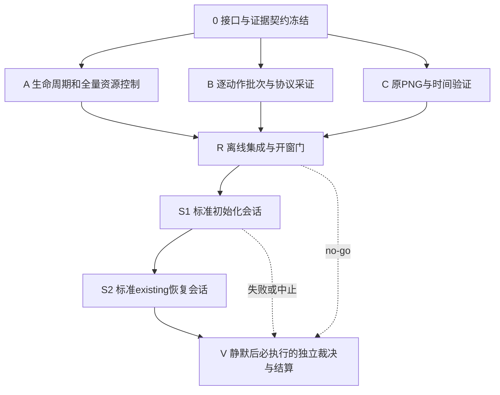

# I13：G-B2 采证与运行控制纠正 PDCA v1

日期：2026-11-02。父节点：I0–I12 / G-B2。统筹：root。固定规划输入：集成 `5884ac9b235c03c33ccfd843d622d26de5948189`、[当前登记](../universe_implementation_register.md)、[I12 partial报告](../evidence/universe-I12B/partial-live-report.md)、既有G-B2契约及[工作流](../parallel_agent_workflow.md)。本文件调整开发过程，不新增世界规则。

**执行结算：I13整体partial；0/A/B/C工具交付接受，R仅被动CLI部分交付、ready no-go，S1/S2 skipped，V完成停止路径结算。未启动新的UE实机窗口，G-B2未过；实际提交/检查/清理见[执行登记](../universe_i13_execution_register.md)。**两名既有subagent只读参与规划，后续实现仍须独立worktree/分支、PR、自检、非owner审查及父节点集成。任务进度、PR状态和门禁状态分别记账。新实现基线必须由统筹固定为准确集成SHA，不能用浮动HEAD替代。

## Check → Act：上一轮结算

| 观察事实 | 评价与下一动作 |
| --- | --- |
| 产品source25abce1完成真实初始化、retain、弱物理D−7及两个Native测试 | 保留有限技术结果；不重做已接受的内核、Genesis provider、存储和严格parser |
| 两次有数据会话normal=false，完整只读矩阵及真实retry/history未收齐 | G-B2未过；先准备逐动作采证及主动退出，再运行，不靠watchdog补正常退出 |
| 三份.png原件实际JPEG；physical时间只有推定区间 | 原PNG缺证；保留原件，用真实PNG导出及捕获区间契约补缺，不能转码冒充 |
| supervisor1148s遗漏额外selector上界1417.649s；总2566s>1200s | I12资源门fail永久保留；新轮独立预算，控制器启动的实例也纳入账本 |
| flat RPATH布局、uppercase GUID、standalone审计guard已有针对修复 | 保留修复；部署helper最终版本尚无新实跑，绑定新源重新检查实际部署入口 |

已证实的是布局/ID/guard缺陷及上述采证、计账不足。额外selector的确切触发调用未独立记录；“旧App binding刷新可能重新拉起”是需防范机制，不能写成已证实唯一根因。新方案耗时、Shot可用性、实际输入读回仍待验证。

## Plan：父节点 I13

目标：在冻结输入下取得两次正常标准会话及完整G-B2证据，可靠退出且全量资源不超卡。世界仍为有限抽象因果技术代理，不宣称写实、通用物理或整个数字宇宙完成。UE发布版插件优先、单权威writer、Genesis候选、UE只读投影不变。

Do：仅修控制/采证缺口，离线审查通过后再串行占用GPU。Check：全部必需子门pass，加独立端到端复核；不加权抵消失败。Act：缺信号inconclusive，实测违反契约fail；只重开受影响节点及下游，旧证据和旧资源账不覆盖。若已完成会话后冻结源/卡发生实质变化，不拼接两个版本凑双会话。

只有A/B/C允许接口冻结后的实现并行。R统一集成共享runner/verifier改动，避免多个worktree同时修改共享文件。运行控制仅一个owner，审查者不同时开UE。

## 叶节点任务卡

以下为冻结发布卡，所有叶节点parent=I13；实际进度/PR/Check由执行登记维护，不以发布卡中的计划当结果。下表路径为未来发布卡的排他所有权，均相对仓库。每个写任务将在 `.worktrees/i13-<slug>` / `codex/i13-<slug>` 从统筹固定SHA创建；本次未创建这些工作树。subagent是角色分配，实际派发时绑定可用agent；owner不得批准自己的门。

### I13-0 / root / depends_on=[]

- P：核对原G-B2阈值，冻结action schema、PID/world/root/head/anchor、前后map、请求响应关联、Shot来源、正常收据和计时接口；列出必需动作及预期trace数量。任何调整需版本差异及理由。
- D：独占 `doc/design/universe-i13-interfaces.md`，输出无未定字段的接口和失败矩阵；不写产品代码。
- C：架构reviewer逐项对原契约及I12缺口审查；不能以此次规划稿替代接口已冻结。每项需给出机器可核对的断言和证据路径。
- A：来源要求不允许native Shot则先解决契约兼容；不得临场降低原PNG要求。接口未定，不派发A/B/C实现。

### I13-A / 生命周期subagent / depends_on=[I13-0]

- P：统一build、启动、交互、正常退出、封存及控制器额外实例预算；先检查精确PID和日志，停止后禁止CUA旧binding访问。
- D：独占新增 `scripts/universe_iteration/lifecycle.py`、对应定向测试及 `doc/evidence/universe-I13A/`；提供runner集成接口，不改共享runner。记录pid+启动时间+argv/所属run，CLI被动检查脱离子进程/额外selector；只处理本轮精确对象。
- C：独立reviewer用受控子进程/假时钟验证提前退出、deadline、超时后UI拒绝、额外实例计账、PID复用拒绝、exit字段缺失拒绝和全部回收。mock通过仅代表控制工具，不代表UE正常门。
- A：有归属未知进程则停开新窗口、保留证据并核实，不全局kill；异常退出是fail，不抹账重试。

### I13-B / 采证流程subagent / depends_on=[I13-0]

- P：冻结短批次CUA动作、每动作before/完成读回/after/恢复证据；显式run/PID/log-offset，不复用旧会话闭包。按原协议构造真实retry/history，明确精确命令、目标head及预期数量。
- D：独占新增 `scripts/universe_iteration/actions.py`、对应定向测试及 `doc/evidence/universe-I13B/`；动作执行仅经CUA，不用终端注入UI事件。
- C：非owner离线验证缺after、陈旧offset、错world/PID/head、无按下/释放/恢复、重复扣费及没有真实请求时均拒绝；输出每动作证据映射。实际相机/visibility/FPS/pause/held-input/历史拒写仍须实机。
- A：输入意图不算动作发生；trace没有retry/history就标缺证，不能用目录或按钮记录代替。

### I13-C / 图像证据subagent / depends_on=[I13-0]

- P：设计稳定verified观察后的UE native Shot，排除启动期HighResShot；定义原生PNG魔数、解码、SHA、PID/world/head及视角绑定。保留请求至稳定落盘的时间区间，mtime不当精确拍摄时刻。
- D：独占新增 `scripts/universe_iteration/capture.py`、对应定向测试及 `doc/evidence/universe-I13C/`；不改共享verifier，不转换JPEG来满足原PNG。
- C：非owner离线拒绝JPEG误名、损坏PNG、旧文件、缺时间边界/身份、重复覆盖；真实Shot可用性在S1验证，当前只是假设。
- A：若S1取不到符合原契约的PNG，收束退出，重开C及下游；不以外部截图替代。

### I13-R / 集成owner，root或第三方非owner审查批准 / depends_on=[I13-A,I13-B,I13-C]

- P：串行接入共享runner/verifier；独立核对PR106部署布局与实际发布入口，冻结源、二进制、配置、卡、action manifest和hash。全程无UE/GPU。
- D：独占 `scripts/run_universe_slice_acceptance.py`、`scripts/verify_universe_slice_evidence.py`、`doc/evidence/universe-I12B/prepare_deployment.py` 的必要接入及 `doc/evidence/universe-I13R/`。不得重写旧报告/原件；新报告独立存放。新增模块只由其owner修改或明确交接。
- C：root审差异；纯离线回放全部失败夹具、布局/RPATH路径、依赖存在性/公共摘要、标准initialize及existing卡、逐动作检查、关闭余量。私钥不读取/复制/摘要/索引。没有现成耗时依据时，标明可行性未知，不宣称mock证明UE耗时。
- A：形成明确ready/no-go及资源决定。未ready、不足退出余量、接口未定均不开窗；需要额外实机可行性试验则先拆独立卡并计费，不能偷偷塞进“离线排练”。

### I13-S1 / 唯一运行owner / depends_on=[I13-R]

- P：沿用现有runner PLAN顺序，在独立新context标准initialize，旧I12世界不reset。ready后先取唯一新文件native Shot，验证magic/解码/时间区间/PID-world-head/视角绑定，并核对当前PID/deadline/quit guard可用；失败立即收束，不另开探针会话。此检查不证明最终正常退出。
- D：仅写新轮DevSSD独占run目录及 `doc/evidence/universe-I13S1/`。严格顺序：initialize(0,0) → retain(0,1) → weak physical(1,2) → 同闭包retry → history(0,1)/(0,0)/latest(1,2) → history_write_rejected → held_input → camera → visibility → framerate → pause → exit1。两个精确Native测试在冻结manifest指定的位置执行。
- C：非owner核对实际请求响应、独立Fraction D/8steps、retry无新提交或重复扣费；每个只读动作有before/完成读回/after/恢复。history的Space及R均拒写且trace无prepare/advance；held Space必须history按下→跨current→释放→释放后读回，禁止在current首次按下产生新推进。相机变化及恢复、隐藏及恢复、FPS改动及复原、pause及resume均逐项留证。两个Native测试必须实际执行且Success。正常完成必须UE/worker真实exit和父wait、supervisor normal=true，退出后只用CLI查残留。
- A：关键断言失败或动作超时提前正常退出；不授S2。清理成功不能改写normal=false。240s交互是否足够尚未知：I13-0/B必须逐命令、marker、maps、截图及恢复列耗时上限，R无法证明分镜可行就no-go，不能删除动作或临场延期。

### I13-S2 / 同一运行owner / depends_on=[I13-S1]

- P：沿用runner revisit，仅标准existing，同冻结源/卡版本/world/root/anchor，新PID/channel；禁止initialize、prepare、advance或额外物理。恢复current(1,2)及历史(0,1)，按原契约证明重访与只读。
- D：新run目录及 `doc/evidence/universe-I13S2/`；fresh status/recovery、exact观察和图片绑定、原PNG/时间区间、完整maps、两进程正常收据。
- C：非owner核对全trace无初始化或推进、两会话源与authority身份相同、exact(1,2)/(0,1)响应与恢复正确、normal=true且无所属残留；观察请求不能只凭按钮/目录认定发生。
- A：错误恢复、额外提交或缺关键证据就收束退出；不以repair-only代替标准会话。实质源变化时两会话重新绑定，旧会话单独保留。

### I13-V / 独立验收subagent，root统筹 / finally=[I13-R,I13-S1,I13-S2]（结算后，不要求pass）

- P：无条件终结器：R no-go、S1探针/正式动作失败、S2中止同样进入V；未派发节点记skipped并说明原因。所有本轮进程静默后才离线复算原件、trace、资源与存储账；缺信号和失败分别裁决。若仍有残留则V先记录fail并维持开窗禁令，由A执行精确归属核查/清理，V不得假定已静默或宣布已完成封存。
- D：独占 `doc/evidence/universe-I13V/`，输出public index、每门pass/fail/inconclusive与限制；root独占更新backlog/实施登记，不复制长日志。
- C：root复核准确source、两标准normal会话、完整动作矩阵、真实retry/history、原PNG/时间区间、全量资源/存储门；索引排除private/key内容并标记快照时点。全部必需门pass才接受G-B2。
- A：失败仅重开最小责任节点及下游；独立已接受结果保留。提交本轮范围文件、PR审查/集成、核验运行依赖后再清理干净worktree；不碰用户脏checkout及I12B六项保留输出。

## 资源卡提案：不是已启动的新窗口

新轮总上限暂提1200s、整个存储≤2GiB，待R明确冻结范围/计量口径及可行性后记录决定。旧I12的2566s/1200s fail始终独立保留。不得自动借用新轮余量重试或靠加预算掩盖控制缺陷。

- 每会话阶段上限：官方build60s、启动至ready60s、交互240s、正常quit/drain/reap40s、会话封存/observer核账20s，共420s；两次计划840s。余360s暂分全局最终封存/核账180s、异常收束及保守计量余差180s；不授权额外readiness会话、第三次运行或重试。冷构建超过60s须在开窗前另定卡，不能暗用余量延长。
- 新实机资源卡的全局墙钟从root dispatch/prelaunch开始，持续到launcher实际wait、所有本轮进程消失、控制器观察结束和最终封存完成；会话端到端计时从build开始（无build则从launch开始）；最迟累计360s发送正常quit，400s前完成正常退出和回收，最后20s只做会话封存/observer核账，420s前完成监督、该会话封存及核账。阶段超限提前收束，不把未用阶段时间默认为交互延期。退出40s及会话封存20s优先预留，提前完成即退出。
- 进程/GPU占用另按实际单调时钟记录；session/build/进程区间分项保留，重叠只按冻结规则计一次，额外非重叠实例补入。独立CLI observer覆盖监督器外/PPID1同bundle进程；未归属但同期发现的UE记contamination、停止新窗口并核实，不能直接杀掉用户进程。未知起止用保守上界，未知exit不写0，不只报监督器subtotal；计量不完整不能pass。
- 离线准备、CPU检查/build、运行、封存各自记录耗时/字节/范围。全局资源卡须说明哪些费用纳入硬门；不能将实际UE或控制器拉起实例列入“离线”以排除。封存结束才结算总账，避免事后遗漏。
- GPU期间不长篇分析或输出大图；动作前检查PID/日志/剩余量，动作后被动查额外实例。发现异常立即收束；锁屏等外部阻塞不消耗GPU等待，先退出再离线处理。

## 当前下一步与恢复入口

规划轮已完成；执行轮实际交付及no-go结算见执行登记。下一轮先按R/Act补真实诊断producer及R13适配，再审运行ready；本轮没有provision、DNS/API变更或新聊天。规划审查反馈和发布状态由[实施登记](../universe_implementation_register.md)维护。调整源、阈值、依赖、预算或必需证据时升级本计划版本并保留旧裁决。

## 本次规划审查结算

验收reviewer指出并修正了初稿会话顺序冲突：最终沿用当前runner PLAN，S1完成物理及全部动作，S2只读revisit，不改变G-B2门语义。原先分配给S2的物理及90s混合只读分镜已撤销；S1完整逐动作240s可行性待I13-B/R验证，不冒称已可行。架构review另要求失败也有独立终审：V改为静默后的无条件终结器，R no-go/S1失败时跳过未运行下游并结算，不需等待S2通过。架构review要求全局dispatch至最终封存、额外实例observer、未知退出不得写0及退出余量，均纳入资源卡。此结算仅接受规划调整，未接受实现或真实门。
