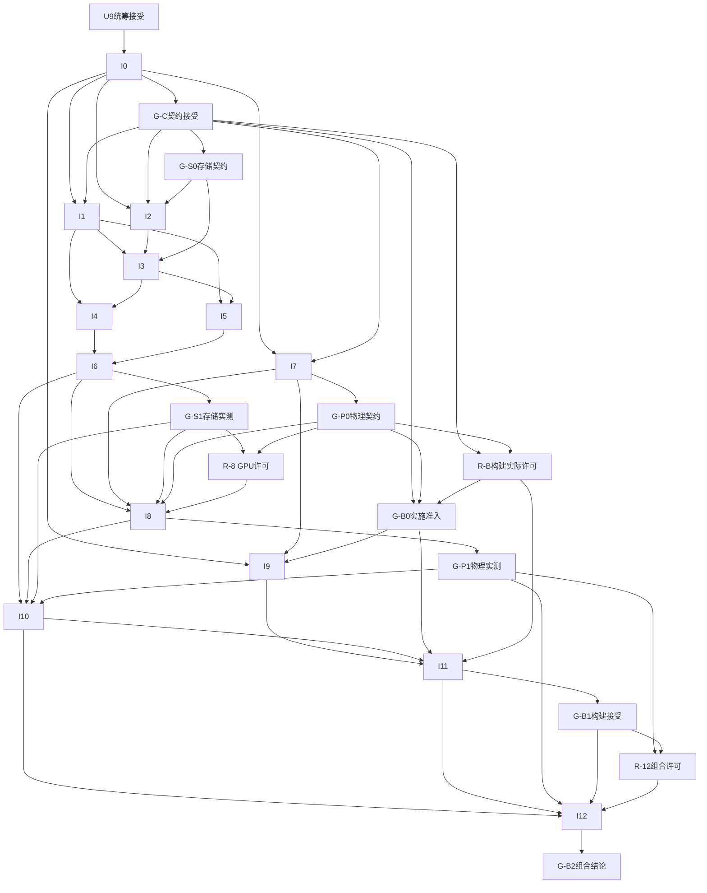

# U9：跨卡架构审查与下一轮实现树

版本 v0.1，2026-11-01；parent=U，depends_on=U4/U8；审查 owner `/root/u9_architecture_review`，未承担 U1–U8 交付。准确基线 `4bb7452115763bbe02534850edb95a20f3e8afb0`，分支 `codex/u9-universe-integration-review`。只交付本文，未修改其他设计、产品、UE 配置或存档。

## 1. 审查裁决与输入身份

**独立设计结论：可接受为有界架构及实现规划，未发现必须重开 U1–U8 的方向性阻断。**下面的共享字节、存储、物理和产品门仍须逐门满足；此结论不放行通用生产运行，也不将提案升级为世界法则。U9 自检和独立架构审查已执行；本 PR 的统筹审阅/CI/集成及 U 根节点收尾由主任务登记，本文件不自宣布合并或整轮关闭。

| 固定输入 | 已接受的设计 source / 本次阅读 |
| --- | --- |
| [U1 身份](universe-identity.md) / [U5 初态](universe-origin.md) | `a7fed69963ac01456ed7fb14edc8f98eef448974` / `ec8bf6eda93ca5219d593e4dff682339080a31e9`，并读[首批复核](universe-u1-u5-integration-review.md) |
| [U2 物理](universe-physics.md) / [U3 AI](universe-ai-proposals.md) | `b78b3ab7e2066fcd350b586aac71fa6b16567a19` / `9f2fe7e54d3475794a1577c18ffe8fdb0c3df58d` |
| [U6 访问](universe-entry.md) / [U7 投影](universe-projection.md) | `95903b2a9432b9843b0b1f6e60b87a866482f878` / `38f8e02f8b4049d2cb0ba19fecf56b6e5d3c846b`，并读[第二批复核](universe-batch2-integration-review.md) |
| [U4 事务](universe-commit-recovery.md) / [U8 预算](universe-scale-quality.md) | `28122b7cbfdb14a16c2c3a75887445cae75b9c59` / `98890bafe73a1403a559f1a8ca6ef7270777ba26`，并读[U4](universe-u4-integration-review.md)/[U8](universe-u8-integration-review.md)修订复核 |
| 原有运行边界 | [G0 决策](../pdca_g0_freeze_decision_record.md)、[S4 工程探针](../seed_tree_genesis_slice_contract.md)、[H6C 有限接受](../evidence/home-visitor-independent-acceptance/coordination-review.md)，只按各自代码/环境版本引用 |

**状态分层：**用户已确定非植物 Seed→Tree、丰富混沌六类场所、不限方块、万物有灵及世界内玩家化身、UE5 发布版优先、唯一权威与观察纯读。U1–U8 是接受的设计输入；新 schema、正式规律、载具权威性、灵域出现时刻、具体地图/授权资产、目标画质/性能仍未冻结。H6C 只证明原准确本机组合路径，不能证明新域、写实、通用 Genesis 化身物理或默认退出可靠性。AI 为未来 M2 可选分支，不阻塞现有 H6C 或本轮无模型内核工作。

## 2. 需求—接口—Check 追踪矩阵

以下运行 Check 均 **planned**；本轮通过的是设计覆盖/边界审查。每个未来运行必须绑定准确代码、fixture/规则/存储 profile、环境、原始请求响应、状态/事件/文件摘要和 run/attempt；无证据不判 pass。

| 需求 / 接口 owner | 正例 / 反例（可判失败） | 实现节点与证据 / 仍需满足的门 |
| --- | --- | --- |
| 丰富混沌与身份；U1/U5 | 同一新 root 含六类地理引用、稳定存在/关系；缺区、跨 world 端点、由 Actor 名自动授灵均拒绝 | I0/I10 清单及 typed 枚举；具体地理是工程 fixture，灵域规律待产品裁决 |
| 时间/水位/版本；U1/U4/U7 | 同 tick 不同 revision 可分别精确观察；错水位/版本不得挑近似当前样本 | I0/I1/I9/I11 黄金字节、拒绝响应、画面身份；新域不能沿用 Tick==Revision 假设 |
| 单 writer/事务；U4 | 别名路径第二进程被拒绝；旧/新完整 root 及结果去重；删锁夺权/悬空 blob/未知仍写均失败 | I2/I3/I5/I6 进程/锁、W0–W9 轨迹；G-S0 profile契约与G-S1实测分开，进程故障不冒充断电验证 |
| 物理进入因果；U2/U4 | 固定前态仅改预声明刺激，发展字段可复算且不同、事件引用候选；仅物理轨迹/hash不同不算通过 | I7/I8/I10/I12 原始求解/配置/绑定/checkpoint/发展字段；G-P0契约、G-P1真实探针分开 |
| 命令/审批/随机；U3/U4 | 已提交同命令响应丢失只返原结果；异内容、过期新动作、错 principal/审批和规则冲突拒绝 | I0/I4/I6 固定 receipt/输入和预算/游标；真实模型/外部账单另属 X-AI，不假装跨服务原子 |
| UE 纯读时间投影；U6/U7 | 当前/历史、LOD/视角变化逐项权威不变；迟到混块/错误碰撞来源不得应用 | I9/I11/I12 ViewBinding、epoch/generation、原图和逐动作 map；G-B0准入/B1构建/B2组合结论分开 |
| 退出重访/输入；U6/U4 | 同 world 重访、历史巡视返回前清输入并验当前支撑；历史 Space、跨会话回调、取消当回滚均失败 | I10/I11/I12 状态机/实际 Pawn/未决 CommandId；不新增 pose 存档，权威载具B留 X-VEH |
| 无玩家/长期演化；U4 | 先固定批次/逐步命令/随机输入，有界离线中断后从原结果续算；漏步/重步或拿大步当逐步等价失败 | I4/I6 有界逐步协议；X-TIME承接自治时钟/休眠/跨区传播，G-T未定不偷偷启用自动Advance |
| 有界规模与质量；U8 | H/S/D/A/bytes 全域计量、配额有余量；缺 GPU、错误 pixels、删失败/历史、超界继续推进均不通过 | I0/I6 只校验计算/正确性，X-Q 才做真实采样；G-Q 批准目标/负载/预算，不挪用旧600帧结论 |

## 3. 跨卡组合与源码差距

组合路径为：新初态清单及显式输入 → 准确 world/principal/head/版本校验 → 查持久幂等结果 → 固定规则图/随机输入/物理配置 → Genesis 候选与发展候选 → 最终准入 **A** → 不可变工件 → 唯一 manifest 可见 **V** → profile 同步确认 **D** → 稳定结果 → UE 纯读样本。退出不撤销已提交世界；未知提交先恢复核对原 CommandId，不新造意图重做。

AI 分支如将来采用：固定输出/提案摘要 → 不含审批/最终指纹的语义命令体 B → 审批绑定 B 摘要 → 最终指纹含不可变审批引用 → 候选 → A。A 不反入指纹；state 排除本次 event/index/manifest hash，event 引 state/旧事件头，结果引 state/event/checkpoint，索引引结果，manifest 最后引这些工件；稳定 EventId 可先分配，不能把稍后 event hash 反塞状态。独立追踪该图未见循环；I0 仍须冻结精确编码并给外部可复算向量，不能拿概念图当实现证明。

锁覆盖初始化/恢复/求解/提交到关闭，Genesis 只有候选写入权，UE 只有本地投影写入权。重启必须先持锁、固定并验证完整可见 root/全部保留引用，再按存储 profile 重建 **D_recovery**；未确认则停新写、明确未确认只读，损坏拒读。A 后撤销/到期语义、外部预留有效性和结算必须冻结；没有协议不能声称即时撤销与 rename 原子一致，外部账簿不能变成第二 world 提交点。

已独立只读核对基线源码：

- `engine/edgeworld_worker/worker.py` 只恢复恰一个实体；`get_dofs_velocity` 不能自行当作世界线/角速度；新两体绑定/接触恢复尚无证明。
- `engine/edgeworld_worker/abstract_causal_worker.py` 有线程锁、旧规范数字 JSON、tick/revision 同增及不可变 checkpoint/manifest 边界，没有新跨进程锁/通用审批/预算/typed profile。`test_commit_boundary.py` 针对旧 worker，目录同步异常在实际 sync 后注入，不等于新域/断电门通过。
- 旧 Host `EdgeWorldCausalGameMode.cpp` 的 Head 校验要求 Tick==Revision，ObserveAt 将 watermark 置 Tick；Space 以最新 head 发命令。新域的同tick异revision与历史动作禁写必须另实现，不能静默放宽旧 S4 parser 或将旧 H6C 转成新门。
- `EdgeWorldCausalActor.cpp` 禁用 Actor Tick；现有 `launch_edgeworld_ue_mac.sh` 硬编码旧 GameMode/日志 marker。新域 Host/启动接线要显式选择域、保留 legacy 默认与原验收身份，不能只换 worker 文件名便声称新世界已接通。

`chaos-demo`、`stg-demo` 的旧存档继续独立。新六区清单、物理和因果若组合，必须由**新的单一 manifest**明确引用，禁止双 worker/head 拼接。旧 `ruleset_version`、canonical 和 hash 仅由显式版本桥接解释；本实现树首轮不自动迁移旧档。

## 4. 放行门与未决项归属

| 门 | 必须交付/谁裁决 | 当前状态与对任务的影响 |
| --- | --- | --- |
| G-C 技术契约 | I0 的 exact schema/canonical/ID/摘要顺序、错误/幂等/水位、内部模块 API、测试输入和大小界；非作者复算、统筹冻结实验版本 | planned；由I0结果产生，不是I0的前置。不需先决定宇宙最终规律，I0 在 U9 被统筹接受后可派 |
| G-S0 存储契约 / G-S1 存储实测 | G-S0在G-C后接受local profile、注册root、锁/别名和V/D/D_recovery预期，供I2/I3实施；G-S1只由I6故障/进程原件与独立检查产生 | 二者planned；I6不依赖自己的G-S1结论。APFS/fsync不证明断电，未知/不支持停写，禁网络盘 |
| G-P0 物理契约 / G-P1 物理实测 | G-P0由I7预声明并审查公共getter/材料/单位/步长/范围/恢复/反事实期望；I8在G-P0和资源准入后运行，其结果才可产生G-P1 | 二者planned；G-P1不作I8前置。U2数值/手性仍提案，旧-7/-35不当新场景期望 |
| G-B0 UE实施准入 | G-C/G-P0已接受，新域wire/投影/历史输入和构建环境明确，按R-B记录该卡构建/NullRHI资源许可 | planned；供I9/I11实施，不含I11或I12尚未产生的结果 |
| G-B1 构建/NullRHI / G-B2 真实组合结论 | G-B1由I11构建/NullRHI及显式入口检查产生，供I12前置；G-B2仅由I12真实组合原件与非实现owner验收产生 | 二者planned；G-B2不作I11/I12前置，保留preflush有限边界，不声称默认退出根治 |
| R-B / R-8 / R-12 实际资源准入 | 分别记录指定卡的构建窗口、I8 GPU窗口、I12组合窗口及实际owner/环境/时间/存储预算；由统筹在对应前置结果明确后登记真实许可 | 均planned；文档中的B-C/B-U/B-G/B-E只是候选上限，不会自行产生资源许可或借用U8配额 |
| G-Q 质量/资源 | 精确 fixture/资产授权、内部pixels、目标机/阈值/负载及整体配额，统筹按产品来源冻结；X-Q 独立测量 | planned；U8 数值全部候选，不能由本审查批准75分钟/16GiB实际运行 |
| G-AI/G-VEH 产品扩展 | AI intent/policy/真实调用费用或载具B/化身/恢复规则分别定卡 | deferred；不进入本轮必需链，不取消总目标 |
| G-T 自治/长期演化 | U4后续owner固定无玩家时钟来源/推进权限、离线等价或误差、跨区传播/因果范围与休眠唤醒；统筹按产品来源裁决 | deferred；显式Advance是已验证工程边界，不代表长期世界只能靠玩家按键，也不授权自动补tick |

U8 计数已独立核算：H含初态，R/C为1+2+30=33，独立长跑1+2+20=23，H8/32/64归档只读；typed初态小计30+余量2≤32，每步增长假设≤4时H64最坏284≤288，R/C160、长跑120。完整schema枚举和新增类别不得遗漏；D/A及几何、资产、历史/checkpoint、审计/孤立工件bytes另账，不能只看S/H称资源受控。候选75min=70+5、16GiB=14.5+1.5算术自洽；每阶段与剩余必需矩阵均须留收尾额，失败attempt计账，必要缺测整体inconclusive。上述核算不构成真实负载、授权资产、参数或性能承诺。

## 5. 下一轮实现树 I（提案）

根 I 的首个目标是**新域无GPU事务内核的可执行证明**，随后才接真实 Genesis 和 UE。U9 被统筹审查接受后，只有 I0 可派；其余每张卡须在依赖的准确合并提交/Check和对应资源门都满足后，由主任务绑定新 worktree/分支/base。下表每卡 version=v0.1、parent=I、单 owner 角色；路径为真实仓库相对路径，未存在路径是拟新增，不是已有实现。

公共约束：只改该卡独占路径；一份 PR、至多两轮定向修订；无GPU卡不导入真实 Genesis、不启动 UE/模型、不安装依赖。每卡 owner 保存命令/准确 build/input/profile 和完整失败原件，非作者复核；主统筹另做父级集成。下列预算为**待发布卡冻结的候选上限**，不借用 U8 的75分钟配额：B-C=单次无GPU检查≤120秒、至多一次定向重跑、原件≤64MiB；B-U=仅UE build/NullRHI≤15分钟、原件≤256MiB；B-G=专属GPU窗口≤10分钟、原件≤1GiB；B-E=两个组合会话合计≤20分钟、原件≤2GiB。无GPU任务随发布卡明确本地执行额度；UE/真实GPU还需R-B/R-8/R-12登记实际准入。缺明确许可/环境/预算的卡保持 not-ready；中止保留原件，不强杀其他任务或删旧档。

令 `P=engine_platforms/unreal/EdgeWorldHost/Plugins/EdgeWorldRuntime/Source/EdgeWorldRuntime/`，`H=engine_platforms/unreal/EdgeWorldHost/Source/EdgeWorldHost/`。这些只是下表路径前缀。

| 卡 / depends_on / owner / 独占路径 | Plan → Do（顺序） | Check / 证据；Act / ready条件 |
| --- | --- | --- |
| **I0 技术契约与可执行黄金fixture** / U9被接受 / 契约owner / `doc/contracts/universe_authority_v0_1.md`、`doc/fixtures/universe_authority_v0_1/`、`scripts/validate_universe_authority_fixtures.py` | 固定新域版本/读写schema/typed有限float/ID作用域、审批摘要顺序、A/V/D/恢复状态、模块API和测试local profile；显式初始化与纯status/observe分开；定义仅实验用中性转移和固定receipt，不暗定生命/灵域法则；提交可运行正反fixture检查器 | B-C；同tick异rev/重复键/错水位/指纹冲突/审批循环反例，黄金字节和digest由非作者另算，不用同函数生成期望并自证。G-C未接受不放行下游；旧S4字节必须保持原样 |
| **I1 codec与记录校验** / I0、G-C / 数据owner / `engine/universe_authority/{__init__.py,codec.py,records.py}`、`tests/test_universe_codec.py` | 实现I0精确profile→严格解码/引用/版本校验→确定编码，不开authority目录、不求解 | B-C；黄金向量逐字节一致，非法数/类型/重复键/错版本拒绝；读写profile混用即返工I1，不能事后改黄金期望 |
| **I2 authority所有权与进程锁** / I0、G-C/G-S0 / 锁owner / `engine/universe_authority/ownership.py`、`tests/test_universe_ownership.py` | 注册root/world身份→稳定fd排他锁→覆盖初始化至退出→异常释放/别名拒绝；无PID超时夺锁 | B-C；两个受控子进程/别名只能一writer、锁文件inode不换，日志/PID/退出原件；局部锁检查失败返工I2，不碰旧worker，最终G-S1留I6 |
| **I3 不可变工件与提交边界** / I1,I2、G-S0 / 存储owner / `engine/universe_authority/store.py`、`tests/test_universe_store.py` | 持锁写候选blob→校验已有内容地址→file/目录同步→manifest temp→V→D→稳定结果；存储API暴露故障注入与未确认状态，不自动恢复写 | B-C；W2–W7注入、坏/悬空blob拒绝；V后未知不能当未提交，完整旧/新root与结果原件。不同步profile不支持时停写，返工I3或重开G-C profile |
| **I4 命令、准入与规则候选** / I1,I3 / 协调owner / `engine/universe_authority/{admission.py,commands.py,rules.py}`、`tests/test_universe_commands.py` | 读取授权/查原结果→精确head/预算/规则DAG→固定输入的假适配器候选→最终A→调用store；世界预算与随机游标随root，外部receipt仅固定测试输入 | B-C；冲突/撤销/错head/规则环/隐藏随机/失败重复预算均拒绝；已提交重试返原结果。测试fake物理不是Genesis证据；真实外部账单不在卡内，未知停相关写 |
| **I5 完整恢复与历史纯读** / I1,I3 / 恢复owner / `engine/universe_authority/recovery.py`、`tests/test_universe_recovery.py` | 同锁固定root→全保留引用验证→profile重同步D_recovery→ready/历史准确水位；不自动GC、补求解或迁移旧档 | B-C；损坏任一历史引用拒读/停写，校验过但恢复同步失败不得ready，未确认只读显式标注；记录全文件map/结果，违规只返工I5 |
| **I6 无GPU内核独立故障验收** / I4,I5 / 非I1–I5实现者 / `scripts/run_universe_authority_faults.py`、`tests/test_universe_process_faults.py`、`doc/evidence/universe-I6/` | 在准确合并树/独立目录用fake候选组装W0–W9、双进程、响应丢失、历史/离线步进；结果经独立裁决产生G-S1，不依赖自己的结论 | B-C；原始JSONL、输入/exit/文件及注入时序、全引用/幂等/预算/游标；校验与D_recovery独立观察。缺任一必需门不接受I根的无GPU内核里程碑；kill/模拟I/O不冒称真实断电 |
| **I7 新物理fixture与API静态核对** / I0、G-C / 物理契约owner / `doc/contracts/universe_physics_v0_1.md`、`doc/fixtures/universe_physics_v0_1/` | 只读核对公开API→预声明两体形状/材料/getter语义/步长/单位/有限范围/恢复、绑定及反事实D期望→非作者审查产生G-P0；不初始化求解器 | B-C；缺getter/接触或映射语义不可虚构；确定配置/正反fixture及GPU采证预算。若需改G-C共享字节先重开I0受影响部分，不边实现边猜 |
| **I8 Genesis新域适配与有界探针** / I6,I7、G-S1/G-P0/R-8 / 物理owner / `engine/universe_authority/genesis_adapter.py`、`scripts/probe_universe_genesis_v0_1.py`、`doc/evidence/universe-I8/` | 真实公共API求候选→稳定绑定/两体恢复→固定两刺激反事实→拒绝非法数/失败；不独自写world head；独立接受后产生G-P1 | B-G；原始数值/配置/设备/对象/候选与checkpoint hash，发展字段D可复算且预期差异成立；仅轨迹/hash不同不通过。材料/接触/恢复失败局部返工，不改UE源码 |
| **I9 新域UE严格观察解析** / I0,I7、G-B0 / UE解析owner / `P/Public/EdgeWorldUniverseObservation.h`、`P/Private/EdgeWorldUniverseObservation.cpp`、`P/Private/Tests/EdgeWorldUniverseObservationTest.cpp` | 在新类消费冻结fixture，严格world/tick/revision/水位/配置/单位及引用；旧Causal parser/旧schema不放宽 | B-U；同tick异revision准确解码、错水位/物理引用/混profile拒绝且不应用；构建/NullRHI仅解析门，不当Metal图或新物理门 |
| **I10 新单root worker与丰富初态组合** / I6,I8、G-S1/G-P1 / worker owner / `engine/universe_authority/{worker.py,world_initialization.py}`、`tests/test_universe_worker.py` | 把六区技术清单、存在/绑定和真实候选纳入一个新root；接status/advance/observe及稳定command，初始化/恢复遵统一所有权与profile，不启动两个旧worker拼接 | B-C假适配器路径；真实路径另按B-G放行。新独立目录tick0/推进/错误/重启原始往返，H/S完整枚举和bytes上界必须满足fixture。旧chaos/stg存档不迁移，失败归到实际接口 |
| **I11 新Host访问与显式启动接线** / I9,I10、G-B0/R-B / UE访问owner / `H/EdgeWorldUniverse{GameMode,Actor,Hud}.{h,cpp}`、`H/EdgeWorldUniverseProtocolTest.cpp`、`scripts/launch_edgeworld_ue_mac.sh`、`tests/test_unreal_universe_launcher.py` | 新模式/Controller消费新域，当前与历史输入门、ViewBinding/epoch/generation、代理几何/碰撞原子切换；launcher显式选择新域/marker、默认legacy保留，先构建所属worktree | B-U；错域/迟到/历史Space/held输入/未知提交返回负例，旧入口回归不被新字段改变。构建/NullRHI与入口检查接受后产生G-B1；真实图由I12产生G-B2 |
| **I12 新域独立组合验收** / I10,I11、G-P1/G-B1/R-12 / 非相关实现owner / `doc/evidence/universe-I12/`、`scripts/verify_universe_slice_evidence.py` | 准确新组合树UE↔worker↔Genesis：丰富初态、两个推进、精确历史/同tick异revisionfixture、只读导航、正常退出重访；同world新root不双写 | B-E；原始JSONL/全引用hash/源build/PID/Metal原图/逐动作authority map/实际exit；事实与假fixture分开，新域真实物理进发展、恢复和观察同门核对。实际结果才可产生G-B2；缺门保留fail/inconclusive，不用截图/PR数替代 |

图中把任务边、合同接受边、真实结果边和资源门全部取并集；`GC/GS0/GS1/GP0/GP1/GB0/GB1/GB2/RB/R8/R12` 分别对应上表同名门，`U9A`是统筹接受本交付。R-B的许可按I9/I11各卡独立登记，不能重复挪用；R-8须在G-S1/G-P0明确后登记，R-12须在G-P1/G-B1明确后登记。DAG前置完成只表示可申请该门，实际派卡还须该门证据pass且资源许可真实存在，不能用拓扑可达伪造许可。G-Q/G-T/G-AI/G-VEH仅接后述deferred分支，不是I0–I12的隐藏前置。

可并行机会是 I0 接受后的 I1/I2/I7，以及 I3 接受后的 I4/I5；I9 可与满足前提的I8并行，但UE构建/NullRHI资源与GPU采证窗口仍由统筹协调。共享契约变更先更新版本/影响边，不把目录独占当作接口兼容证明。I0内部模块API必须足以让这些owner独立实现；必要的新公共文件由I0分配给唯一后续owner，不允许两卡各写同一文件。

## 6. 总目标后续分支与实际 Check/Act

**X-AI**（U3/U4，I6后且G-AI冻结）再拆固定提案协议→真实模型/评估集，单独拥有未来 `engine/universe_ai/`；没有预算/allowlist先不派真实调用。**X-VEH**（U6/I12后且G-VEH冻结）另定A访问载具或B权威载具，不能从本地碰撞推出Genesis载具物理。**X-Q/CONTENT**（U7/U8/I12后且G-Q冻结）再拆授权资产、六区真实通行、水体/光照/LOD、采样及独立质量门；未来 `engine_platforms/unreal/EdgeWorldHost/Content/Universe/`、`scripts/measure_universe_quality.py` 的所有权须在细分卡重新锁定。**X-TIME**由后续演化/调度owner在I6后接U4逐步离线协议，经G-T再拆 `engine/universe_evolution/` 的自治调度、休眠结算/近似等价及跨区传播；无玩家不等于无因果输入，不能让UE帧率或当前墙钟重写历史。本树四者均为deferred分支，尚非可直接派发叶卡；完整实现/证据卡须按同一PDCA格式展开，不能把目录预留当内容或运行授权。

**本卡 Plan/Do：**固定八份设计与原证据身份，独立复核边界和源码差距，形成追踪矩阵、门和有界实现树；只写本文。**Check（已执行）：**15个本地链接均存在，八个上游source均为固定基线祖先；13张叶卡展开为42个独占路径，无重复或跨卡目录前缀覆盖。U设计依赖、I任务与外部门并集（25节点/54边）及摘要图均拓扑无环，Mermaid边与检查表相同；H/S、75min/16GiB算术通过，单文档范围和差异格式检查通过。统筹预审指出的G-B含义混用已拆B0/B1/B2，门/资源也进入图；原未定义I-A标识已移除。未运行任何UE/Genesis/模型/故障/压力，也未重新验证原始H6C文件，因此其运行通过只按既有报告引用。**Act：**主统筹审查本交付及PR后可接受本设计轮产物、压缩上下文；只解锁I0发布，不直接启动I1–I12或扩大产品门。设计原则若被实现反例推翻，保留失败原件，仅重开相应接口/卡与下游，不因已合并设计强行实现。
