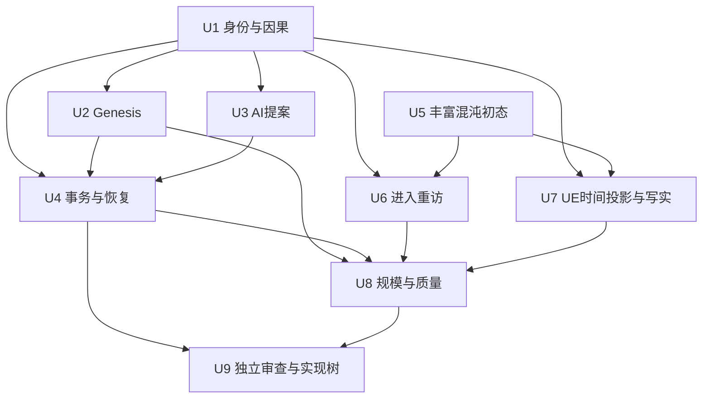

# AI 4D 数字宇宙：下一阶段架构设计树

版本：v0.1，2026-11-01；固定输入基线 `f674483`。父节点 G，设计节点 U。本文经统筹合成两份只读 subagent 提案，规定下一阶段设计任务，不批准新的世界法则，也不宣称产品运行验收通过。

## 目标、现状与设计原则

终点是人类能通过载具进入、游玩、退出和重访的持久 AI 4D 数字宇宙。初始混沌世界已有城市、蛮荒、原野、森林、海洋、河泽；混沌指秩序、归属与意义尚待确立，不是没有内容。空间不限定方块。玩家世界内化身属于世界之灵，账号与外部操作者另行建模。

已定：Seed→Tree 表达抽象初态经因果影响形成发展结构；Genesis 是现有纵切必需路径；唯一权威提交，逻辑时间与渲染帧分离；UE5 发布版插件/适配优先。AI、完整载具、最终写实和规模化属于总目标，尚非当前 V-HOME 必需门。

已观察：UE↔worker↔Genesis 有有限 Metal 往返、历史和恢复证据；可步行实现 H6B 已集成，H6C 独立验收进行中；BasicShapes、局部碰撞和两相刚体探针不能替代完整世界、写实物理或真实演化规律。显式 viewport-preflush 开发入口有限接受，原默认退出可靠性、reporter 自身退出及正式性能门仍开放。

**基础单元设计建议：**以“可标识、可关联、可追溯变化的世界存在”作为逻辑建模入口。其表现可以是物体、生命、河流、城市、区域或玩家化身；不是每个可见三角形都必须有独立权威实体，也不把所有存在强制拟人化。候选结构分开表示身份、状态、关系、规则引用、事件历史与投影引用；“何时取得独立灵域、如何分化/合流、谁可拥有”仍须产品裁决。此建议由 U1 比较细化，尚不替换旧 schema。

## 架构边界提案

```text
世界起源清单 / 显式外部动作 / AI 提案
                  ↓ 输入校验、权限、规则版本和预期 revision
单权威协调器 → Genesis 候选求解 → 演化规则候选 → 一致性校验
                  ↓ 唯一事务提交
不可变状态/物理 checkpoint/事件记录 ← 唯一 manifest head
                  ↓ 指定 tick + watermark 的只读观察
UE5 发布版投影、世界流送、载具/步行视角、历史显示
```

AI 只产提案，Genesis 只产候选；都不直接替换世界 head。UE 本地运动/碰撞可以服务观察体验；若动作要对世界产生因果影响，必须转成版本化权威命令。UE 视觉动画、流送和历史查询不触发权威求解。上述为后续契约方向，现有有限实现的覆盖范围仍以原证据为准。

## 能力里程碑

| 里程碑 | 用户能获得的能力 | 放行门与当前状态 |
| --- | --- | --- |
| M0 可访问因果实验室 | 进入、走近、显式推进、回看、退出重访 | H6C 正在独立检查；不等于写实世界完成 |
| M1 有身份和历史的世界片段 | 看见丰富初态，并追溯一条变化的来源 | U1/U2/U5/U7 契约与对应实现、同一世界集成检查；实现未派发 |
| M2 AI 可参与的演化 | AI 提案经规则校验成为可解释事件，违规提案无副作用 | U3/U4 拒绝、提交与恢复矩阵；实现未派发 |
| M3 可登陆和重访 | 载具入口与步行、历史、存档身份衔接 | U6 同 world、会话/化身分离和恢复；载具权威性待定 |
| M4 有界写实数字世界 | 授权资产、连续区域、稳定流送及可量测运行 | U7/U8 冻结视觉/负载/性能门后独立实测；当前未通过 |

里程碑是能力路线，不是日期承诺；可并行设计，不越过依赖集成。M1 不以单刚体投影冒充物理世界，M2 不以聊天输出冒充世界变化。

## U 设计轮：PDCA 根节点

- **Owner / 状态：**主会话统筹；设计轮进行中，运行实现未派发。
- **Plan：**固定上述基线、用户决定及 S4 技术契约，形成可评审的架构接口和实现分工；每叶卡最多一份主设计、一个正例和一个反例矩阵。未决项给备选、影响和推荐，不无限研究。
- **Do：**先完成本方案树，再按 ready 顺序发布独立设计卡。每卡单独 worktree/分支/PR，准确基线在发布时重新绑定；仅写该卡文档。两位只读规划 agent 的反馈已用于本方案树，尚不代表叶卡交付。
- **Check：**非作者检查所有需求有来源、字段有所有者、依赖无环、正反例有可判结果；统筹检查跨卡身份/单位/时序兼容。设计通过仅放行对应实现规划，不能将未来运行检查标 pass。
- **Act：**冲突只重开对应设计及下游；保留已审查的独立结果。总设计轮关闭须 U1–U9 必需设计交付经审查、产品未决明确登记、上下文提交；H6C 作为独立运行分支单独记录，不提前关闭 V-HOME。
- **资源：**设计轮不启动 UE/Genesis、不占 GPU、不下载资产、不调用付费模型；每卡一轮方案与至多两轮定向修订，仍未收敛则拆卡或记录待决。实现预算和性能阈值另行冻结。

## 设计叶卡与拓扑

所有卡 version=v0.1、parent=U；固定公共输入为 `f674483` 的总图、G0 决策记录、S4 契约及 backlog。依赖交付须绑定接受后的 commit/version。下列 owner 是角色，发布时绑定具体 agent；U1/U5 已按用户批准从 `5a5fe11` 发布并经独立 PR 集成、设计门接受，具体 owner/worktree/门状态见[执行登记](universe_design_execution_register.md)。其余卡尚未派发。

| ID / owner / depends_on / 独占交付路径 | Plan 与 Do | Check：设计检查与未来运行判据 | Act |
| --- | --- | --- | --- |
| U1 世界身份与因果状态 / 权威设计 agent / 无 / `doc/design/universe-identity.md` | 对照旧状态模型；比较实体/区域/关系与灵域身份，定义稳定 ID、版本、读写矩阵和演化模块边界；列分化/合流备选，不制定法则 | 设计审查每个字段唯一归属、重复命令/错 revision/缺历史有明确结果；未来运行双写或观察推进即失败 | 冲突返工最小身份域；语义待决回产品决策表 |
| U2 Genesis 因果边界 / 物理设计 agent / U1 / `doc/design/universe-physics.md` | 从中性 probe 到有界物理对象的最小扩展提案；单位/坐标、步长、候选 hash、误差与物理失败传播 | 给一个版本化工程 fixture 的固定前态反事实正例及非有限值反例，预声明候选映射的发展字段差异（不是已批准世界规律）；未来仅组合 hash/轨迹变化不能算演化通过 | 区分求解/映射/规则缺口；不预设完整生态或跨设备位级一致 |
| U3 AI 提案与权限 / AI 接口 agent / U1 / `doc/design/universe-ai-proposals.md` | 提案身份、模型/输入来源、水位、有效期、预算、权限与审核策略；固定模型输出供协议重放 | 过期、越权、同 ID 异内容、错 schema 的拒绝矩阵完整；未来拒绝前后 manifest 应不变；不承诺模型每次生成相同输出 | 收紧验证门；模型质量评估另拆卡，不挤入当前 V-HOME |
| U4 事务、调度与恢复 / 存储设计 agent / U1,U2,U3 / `doc/design/universe-commit-recovery.md` | 规则依赖/触发/冲突顺序、随机流、物理候选、事件与 command 去重同 revision；比较跨进程 writer lock、原子 head、迁移和离线结算方案 | 列每个持久写点及超时/崩溃注入预期；恢复只见完整旧/新 head，结果不确定须停写；离线跳步不得默认等价逐步求解 | 收敛单机最小协议；分布式写入延期，不沿用“已有单进程”作为锁证据 |
| U5 丰富混沌初态 / 世界设计 agent / 无 / `doc/design/universe-origin.md` | 六类场所共存的连续区域样本提案、待审地理连接与生成清单；区分形态、身份、规则、随机源与可重建视觉资产 | 提交路线图、字段归属及固定 seed 示例；缺任一场所、所提水系内部连接自相矛盾、未决规律冒充已定均设计失败；具体接壤和水系拓扑尚待审定；未来检查清单重现性 | 保留既有 CHAOS→ONE 证据身份，不把旧 TWO 提案自动批准 |
| U6 进入、载具与重访 / 访问设计 agent / U1,U5 / `doc/design/universe-entry.md` | 外部会话→载具入口→步行→退出→重访状态机；比较纯访问载具/权威实体载具；设计可引用 H6B，实施前须收齐 H6C 结论 | 状态转移逐条有 world/化身/权限/恢复定义；未来两次进入同世界、读操作不推进；载具碰撞用 UE 还是 Genesis 须显式归属 | 选择未定先设计两条边界；H6C 失败只阻塞受影响实现 |
| U7 UE 写实与时间投影 / UE 呈现 agent / U1,U5 / `doc/design/universe-projection.md` | 比较 Landscape/World Partition、Nanite/Lumen、水体和植被适用性；当前/历史样本到资产、碰撞与流送的映射；资产授权清单及视觉参考候选 | 设计对照表能追到来源状态/资产/时间水位；未来固定路线 Metal 原图、只读摘要与批准参考逐项比较；来源缺失不接受 | 资产、光照、流送局部返工；无实测契约缺口不提源码修改 |
| U8 规模与质量预算 / 性能设计 agent / U2,U4,U6,U7 / `doc/design/universe-scale-quality.md` | 有界空间/实体/活跃比例、流送、恢复与长跑负载；CPU/GPU/内存/存储采样、有效样本和中止条件；分区只先比较方案 | 每项指标有单位/环境/采法/阈值状态；未来缺 GPU 信号判 inconclusive，批准后越阈判 fail；600 帧试采不能外推产品性能 | 先冻结目标机与预算再排正式采证；不承诺无限世界/多人规模 |
| U9 跨卡集成审查与实现树 / 未承担 U1–U8 交付的 reviewer + 统筹 / U4,U8 / `doc/design/universe-integration-review.md` | 对照 U1–U8，合成“初态→物理候选→提交→UE观察→重启重访”场景，并为未来 M2 单列 AI 候选分支；该分支不阻塞当前 V-HOME/H6C；产出下一轮实现卡及路径锁 | 追踪矩阵无遗漏、写入归属无冲突、DAG 无环；每个未来运行门有正反例/原始证据/独立 owner；未决项不混作验收标准 | 接受设计或定向返工；只放行接口和阈值已满足的实现子树 |



派发顺序：`{U1,U5} → {U2,U3,U6,U7} → U4 → U8 → U9`；每批仍逐卡检查依赖，不要求无关分支等齐才开始。四个并发槽中一个保留主统筹；H6C 已完成并释放 GPU，后续设计按剩余槽调度，仍不得与新的运行验收争用 GPU。

## 产品决策与检查状态

开放：独立灵域产生/消亡、分化/合流、正式演化规律；载具是否权威实体；世界尺寸/在线人数/离线结算语义；写实参考/资产预算/目标机器和性能可靠性数值。设计 agent 应给小规模可测建议及替代成本，统筹集中裁决必要项，减少零散人工确认。

本设计轮已检查九卡路径唯一、表格依赖一致、DAG 无环和当前文档本地链接有效；`shutdown_next_plan` 非作者只读复核无阻断 U1/U5 的问题，关于工程 fixture、地理提案与 AI 分支的三项语义建议已纳入。方案树检查已通过；U1/U5 的 owner 自检、非作者审查和局部集成设计门已完成，其他叶卡与新运行门均为 `planned`。已有 H6B、Genesis 等结果只作为标明版本的输入，不转移为新门通过。后续叶卡提交须分别记录工作状态、PR状态、门状态及裁决；U1/U5 的局部设计门现已通过，见[首批集成审查](design/universe-u1-u5-integration-review.md)；其余叶卡和新运行门仍 planned。U 总轮继续。
